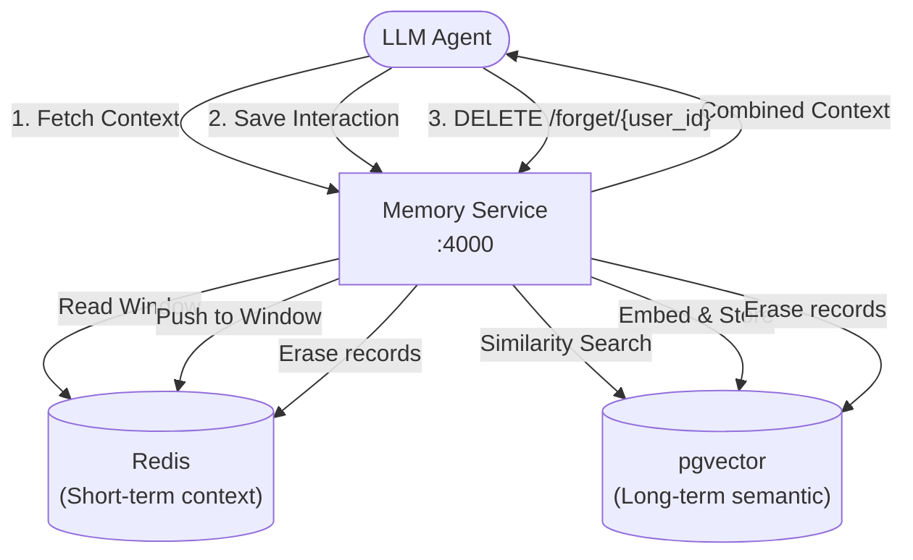

# Architecture — agent-orchestration-memory
> Last updated: 2026-08-29 | Maturity: Partial Prototype
> _Memory management system for agents with privacy controls._

## System Diagram

## Component Table
| Component | File | Responsibility | Tech |
|---|---|---|---|
| API Server | `src/app.ts` | Memory read/write/forget endpoints | Express.js |
| Vector Store | `src/vector.ts` | Semantic search and storage | pgvector |
| Cache | `src/cache.ts` | Sliding window conversation history | Redis |

## Dependency Honesty Table
| Dependency | Status | Notes |
|---|---|---|
| pgvector | **Real** | Used for semantic search (can be mocked with in-memory arrays for unit tests). |
| Embedding API | **Mocked** | Stubbed out to return deterministic arrays instead of calling OpenAI. |

## Component Breakdown
- **Core Technology**: TypeScript, LangGraph.js, ChromaDB
- **Design Paradigm**: Emphasizes high availability, fault tolerance, and security.