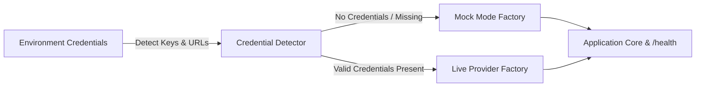

# Architecture — agent-orchestration-memory
> Last updated: 2026-08-29 | Maturity: Partial Prototype
> _Memory management system for agents with privacy controls._

## System Diagram

## Component Table
| Component | File | Responsibility | Tech |
|---|---|---|---|
| API Server | `src/app.ts` | Memory read/write/forget endpoints | Express.js |
| Vector Store | `src/vector.ts` | Semantic search and storage | pgvector |
| Cache | `src/cache.ts` | Sliding window conversation history | Redis |

## Dependency Honesty Table
| Dependency | Status | Notes |
|---|---|---|
| pgvector | **Real** | Used for semantic search (can be mocked with in-memory arrays for unit tests). |
| Embedding API | **Mocked** | Stubbed out to return deterministic arrays instead of calling OpenAI. |

## Component Breakdown
- **Core Technology**: TypeScript, LangGraph.js, ChromaDB
- **Design Paradigm**: Emphasizes high availability, fault tolerance, and security.

## Progressive Credential Loading & Production Architecture (v0.2.0)

This service implements the **Progressive Credential Loading (PCL)** pattern, decoupling development speed from external infrastructure provisioning:

### Core Architecture Components
1. **Mode Detection Singleton:** Inspects environment configuration at boot time without hard crashes on missing secrets.
2. **Dual-Mode Factory Wrappers:**
   - **Storage / Cache:** In-process maps or SQLite `:memory:` transparently promote to managed Redis or PostgreSQL when connection strings are supplied.
   - **AI Providers:** Deterministic heuristic generators and local embeddings transparently promote to live OpenAI, Anthropic, or Gemini API clients.
3. **Hot-Reload & Dynamic TLS:** File watchers monitor mounted volume paths (Kubernetes ConfigMaps and Secrets) to update certificates and limit configs atomically without process restarts.
4. **Health & Observability:** The `/health` endpoint exposes real-time runtime mode metadata (`mock` vs `live`) across all backing adapters.
